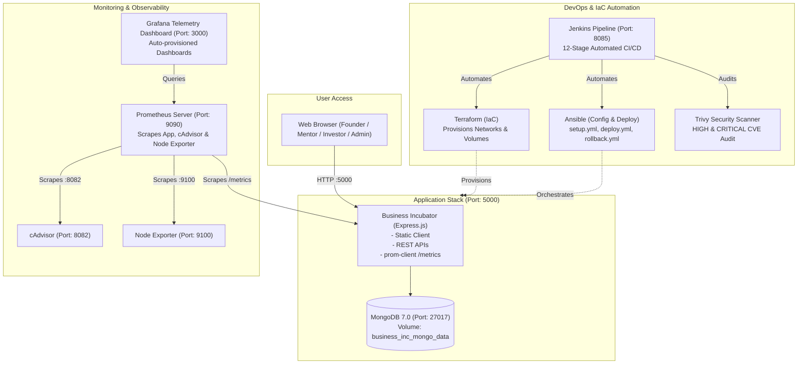

# Automated Application Deployment and Infrastructure Configuration Using DevOps Tools

**Target Application**: Business Incubator Platform (`business-inc`)  
**Repository**: [https://github.com/thowfiq-ahamed/business-inc](https://github.com/thowfiq-ahamed/business-inc)  
**Project Classification**: Advanced Autonomous DevOps, DevSecOps, IaC & Observability Implementation

---

## 1. Executive Summary & Overview

This project provides an automated, enterprise-grade deployment and operations framework for the **Business Incubator** platform using industry-standard DevOps tools:
- **Terraform**: Declarative Infrastructure as Code (IaC) provisioning isolated Docker networks and persistent storage volumes.
- **Ansible**: Idempotent configuration management, environment validation, deployment orchestration, and automated recovery.
- **Docker & Docker Compose**: Multi-stage, non-root, resource-constrained containerization for the application and database.
- **Jenkins**: Primary CI/CD automation engine executing a 12-stage declarative pipeline with automated rollback.
- **GitHub Actions**: Cloud continuous integration, code auditing, and container registry publishing.
- **Trivy**: DevSecOps container security and CVE vulnerability auditing.
- **Prometheus & Grafana**: Telemetry scraping, custom Prometheus metrics instrumentation (`prom-client`), and auto-provisioned real-time dashboards.

---

## 2. Architecture & System Flow

---

## 3. Preserved Application Features

The original Business Incubator platform features remain 100% operational:
- **Founder Features**: Registration, authentication, startup submission, editing, and deletion.
- **Mentor Features**: Profile creation, expertise listing, mentor request review, acceptance, and rejection.
- **Investor Features**: Registration, investment opportunity browsing, interest logging, and portfolio tracking.
- **Admin Dashboard**: Verification review for startups and mentors (`http://localhost:5000/admin.html`).
- **Resource Hub & Inquiries**: Knowledge base browsing and contact message submission.
- **Security & Integrity**: Rate limiting, password reset expiration, and token authentication.

---

## 4. One-Command Operations (Makefile & CLI)

| Command | Action Performed |
| :--- | :--- |
| `make setup` | Inspects system tools, creates `.env` files, and installs dependencies |
| `make test` | Executes the 5-point automated test suite (`node:test` + `supertest`) |
| `make build` | Builds the production multi-stage Docker image |
| `make infra-init` | Initializes the Terraform Docker provider plugin |
| `make infra-plan` | Previews infrastructure provisioning plan |
| `make infra-up` | Declaratively creates Docker bridge network and persistent volumes |
| `make deploy` | Launches the complete stack via Docker Compose |
| `make health` | Verifies HTTP status across application and monitoring endpoints |
| `make scan` | Executes Trivy vulnerability audit for CVEs |
| `make monitor` | Activates cAdvisor and Node Exporter profiles |
| `make jenkins-up` | Starts dedicated Jenkins CI/CD automation server on port 8085 |
| `make rollback` | Simulates deployment failure and triggers automated Ansible recovery |
| `make destroy` | Safely destroys provisioned infrastructure and removes containers |

---

## 5. Live Service Endpoints Matrix

| Service | Host URL | Description | Default Credentials |
| :--- | :--- | :--- | :--- |
| **Business Incubator Web App** | [http://localhost:5000](http://localhost:5000) | Main application web interface | Demo accounts below |
| **Prometheus Telemetry Metrics**| [http://localhost:5000/metrics](http://localhost:5000/metrics)| Native Node.js & HTTP metrics | Public |
| **API Health Probe** | [http://localhost:5000/api/health](http://localhost:5000/api/health) | Uptime and status JSON probe | Public |
| **Prometheus Server** | [http://localhost:9090](http://localhost:9090) | Metric queries and alert status | Public |
| **Grafana Dashboard** | [http://localhost:3000](http://localhost:3000) | Live visualizations and charts | `admin` / `admin` |
| **Jenkins CI/CD Automation** | [http://localhost:8085](http://localhost:8085) | Declarative 12-stage pipeline | Admin setup |
| **cAdvisor Container Telemetry**| [http://localhost:8082](http://localhost:8082) | Real-time container metrics | Public |

### Demo Accounts for Application:
- **Founder**: `founder@example.com` / `password123`
- **Mentor**: `mentor@example.com` / `password123`
- **Investor**: `investor@example.com` / `password123`
- **Admin**: `admin@example.com` / `password123`

---

## 6. Project Documentation Index

Detailed engineering documentation is organized inside `docs/`:
- **[docs/ARCHITECTURE.md](docs/ARCHITECTURE.md)**: Deep dive into network topology, volumes, data flow, and Mermaid diagrams.
- **[docs/DEVOPS_GUIDE.md](docs/DEVOPS_GUIDE.md)**: Operator instructions for Terraform, Ansible, Docker, Jenkins, and Trivy.
- **[docs/COLLEGE_DEMO_GUIDE.md](docs/COLLEGE_DEMO_GUIDE.md)**: 5-minute presentation script, demonstration steps, and Viva Q&A guide.
- **[docs/TESTING_REPORT.md](docs/TESTING_REPORT.md)**: Test execution results, code coverage, and acceptance sign-off.
- **[DOCKER_CICD_README.md](DOCKER_CICD_README.md)**: Cloud deployment to Render and GitHub Actions registry workflows.
