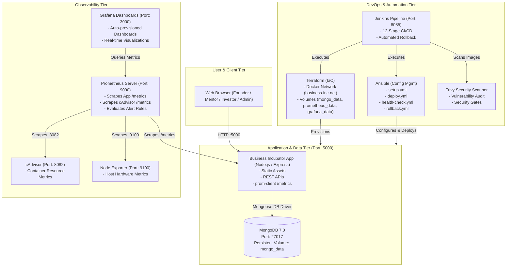
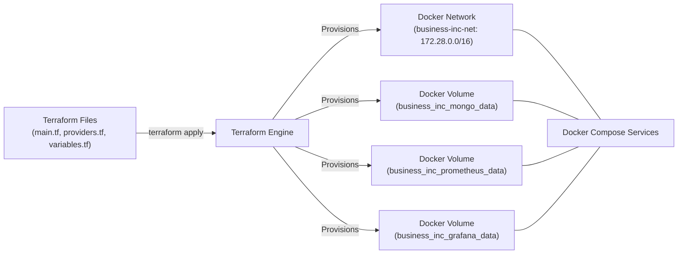
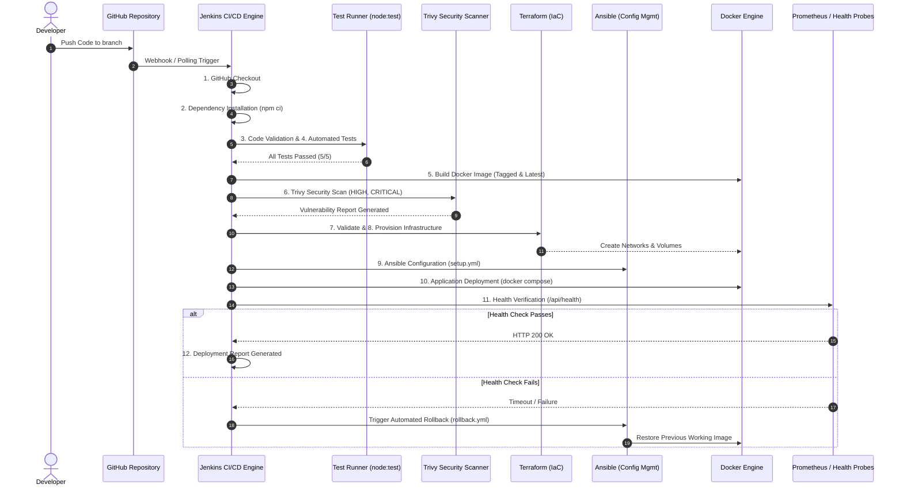

# Architecture Specification

**Official Project Title**: Automated Application Deployment and Infrastructure Configuration Using DevOps Tools  
**Application Target**: Business Incubator Platform (`business-inc`)  
**Deployment Model**: Containerized Microservices with Automated CI/CD, IaC, and Monitoring

---

## 1. High-Level System Architecture

The Business Incubator platform consists of an Express.js backend serving both static client assets and RESTful API endpoints, backed by a persistent MongoDB database. The entire ecosystem is deployed, provisioned, configured, and monitored using modern DevOps tools.

---

## 2. Infrastructure as Code (IaC) - Terraform Architecture

Terraform is implemented with the `kreuzwerker/docker` provider to provide declarative, reproducible, and immutable local infrastructure.

---

## 3. CI/CD Pipeline Flow (Jenkins & GitHub Actions)

The primary CI/CD automation engine demonstrated is **Jenkins**, utilizing a comprehensive 12-stage declarative pipeline. GitHub Actions operates in parallel for cloud validation and continuous integration.

---

## 4. Observability & Monitoring Architecture

The metrics telemetry stack is completely decoupled from application business logic, using Prometheus pull model:

1. **Application Layer**: Express app instantiates `prom-client`, recording request counts, latency histograms, Node.js memory/CPU, and MongoDB connection state at `/metrics`.
2. **Prometheus Layer**: Scrapes `/metrics` every 15 seconds, computes rates and quantiles, and triggers alerts on degradation.
3. **Grafana Layer**: Automatically provisions the Prometheus data source and renders the custom *Business Incubator - DevOps Monitoring* dashboard.
4. **Host & Container Layer**: cAdvisor and Node Exporter collect kernel, CPU, disk I/O, and container-level resource statistics.
